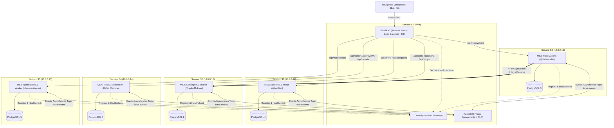

# FORSA (فرصة) — Plateforme Solidaire Anti-Gaspillage Alimentaire 🌱

[](https://nodejs.org)
[](https://www.typescriptlang.org)
[](https://www.postgresql.org)
[](https://www.rabbitmq.com)
[](https://traefik.io)
[](https://www.consul.io)
[](https://www.prisma.io)

Projet académique réalisé dans le cadre du module **WAMS (Web Architectures & Microservices)**  
**Niveau :** ING4 – Génie Logiciel (S7)  
**Établissement :** Université M'Hamed Bougara de Boumerdès (UMBB)  
**Superviseur :** Dr. Yahiatene Youcef  

---

## 👥 Équipe Projet & Répartition des Microservices

| Service | Domaine Métier | Étudiante Responsable | Profil GitHub | Serveur Déploiement | Port Interne |
| :--- | :--- | :--- | :--- | :--- | :--- |
| **MS1** | **Accounts & Shops** (Auth RS256, Profils, Justificatifs) | **Hambli Hiba** | [@hyb0hb](https://github.com/hyb0hb) | Serveur S1 (`10.0.0.11`) | `3001` |
| **MS2** | **Catalogue & Search** (Offres, Géolocalisation, Stock atomique) | **Mokrani May Lydia** | [@Lydia-Mokrani](https://github.com/Lydia-Mokrani) | Serveur S2 (`10.0.0.12`) | `3002` |
| **MS3** | **Reservations** (Réservations, QR Code, Validation retrait) | **Rebahi Doua** | [@Itshannahh](https://github.com/Itshannahh) | Serveur S3 (`10.0.0.13`) | `3003` |
| **MS4** | **Trust & Moderation** (OCR Tesseract.js, Avis, Signalements) | **Rafes Maroua** | @Rafes-Maroua | Serveur S4 (`10.0.0.14`) | `3004` |
| **MS5** | **Notifications & Worker** (E-mails Nodemailer, In-App SSE) | **Khoumeri Asma** | @Khoumeri-Asma | Serveur S5 (`10.0.0.15`) | `3005` |
| **S0** | **Infrastructure & Passerelle** (Traefik v3, Consul, RabbitMQ) | Équipe FORSA | - | Serveur S0 (`10.0.0.10`) | `80`, `8500`, `5672` |

---

## 🏗 Architecture Globale du Système

Conformément au cahier des charges WAMS, chaque microservice possède **sa propre base de données PostgreSQL isolée** sur son serveur dédié. Le routage et la découverte sont gérés dynamiquement par **Traefik v3** et **Consul**, et les échanges asynchrones transitent par **RabbitMQ** (Topic exchange avec Dead-Letter Queue).



---

## 📚 Documentation Technique

* [**Contrat des Événements RabbitMQ (`docs/events.md`)**](docs/events.md) : Schémas JSON stricts de tous les messages asynchrones.
* [**Décisions d'Architecture Validées (`docs/decisions.md`)**](docs/decisions.md) : Justifications techniques (RS256, seuils, isolation DB).
* [**Stratégie Base de Données (`docs/database-strategy.md`)**](docs/database-strategy.md) : PostgreSQL par service, migrations Prisma, Snapshots.
* [**Workflow Git & Collaboration (`docs/git-workflow.md`)**](docs/git-workflow.md) : Règles de branches, Pull Requests et conventions de commits.
* [**Roadmap Équipe (`docs/roadmap-equipe.md`)**](docs/roadmap-equipe.md) : Planning détaillé étape par étape pour chaque membre.

---

## 🚀 Démarrage Rapide (Développement Local)

### 1. Cloner et installer les dépendances
```bash
git clone https://github.com/Lydia-Mokrani/FORSA.git
cd FORSA
git checkout develop
npm install
npm run build:common
```

### 2. Démarrer l'infrastructure centrale (S0)
```bash
npm run dev:infra
```
* **Dashboard Traefik :** [http://localhost:8080](http://localhost:8080)
* **UI Consul :** [http://localhost:8500](http://localhost:8500)
* **Management RabbitMQ :** [http://localhost:15672](http://localhost:15672) *(guest / guest)*

### 3. Lancer votre microservice (Ex: MS1 Accounts)
```bash
# Générer le client Prisma
npm run prisma:ms1

# Démarrer MS1 en mode hot-reload
npm run dev:ms1
```

---

## 🔒 Sécurité et Conformité
* Signature asymétrique des tokens d'authentification (**JWT RS256**).
* Clés privées et fichiers `.env` exclus du contrôle de version.
* Accès aux pièces justificatives commerçants restreint strictement au rôle `ADMIN` sur volume Docker privé.
* Résilience et tolérance aux pannes via **Dead-Letter Queue (DLQ)** RabbitMQ.
