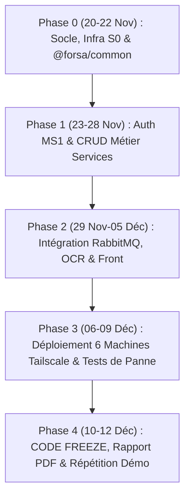

# FORSA (فرصة) — Stratégie de Travail & Roadmap par Membre
**Objectif :** Livraison complète du pipeline microservices au 10 Décembre 2026 (Code Freeze)  
**Supervision :** Dr. Yahiatene Youcef (WAMS — ING4 GL Semestre 7)  
**Méthodologie :** Contract-First, Monorepo, 5 Développeuses Full-stack (1 Microservice + Pages Front associées chacune)

---

## Vue d'Ensemble des Responsabilités

| Membre | Microservice | Responsabilités Backend | Écrans Frontend Assignés |
| :--- | :--- | :--- | :--- |
| **Personne 1 (Hiba)** | **MS1 – Accounts & Shops** | Auth JWT RS256, Profils, Boutiques, Upload documents, Changement de rôle | Inscription, Connexion, Profils, Ma Boutique, Dépôt Justificatifs, Bouton Switch Mode |
| **Personne 2** | **MS2 – Catalogue & Search** | CRUD Offres, Stock atomique, Géolocalisation Haversine, Cron expiration | Accueil, Explorer les offres, Fiche détail offre, Dashboard commerçant (Mes offres) |
| **Personne 3** | **MS3 – Reservations** | Réservations, Génération QR/Code, Validation retrait magasin, Compteur no-show | Modale de réservation, Mes réservations (client), Écran de validation retrait (scanner QR commerçant) |
| **Personne 4** | **MS4 – Trust & Moderation** | Moteur OCR Tesseract.js, Gestion signalements (seuil 5), Avis & Notes, Modération | Panneau Administrateur complet, File de vérification manuelle OCR, Formulaire de signalement |
| **Personne 5** | **MS5 – Notifications + Infra** | Consommateur RabbitMQ, Mails Nodemailer, Traefik v3, Consul, Package `@forsa/common` | Cloche de notifications in-app, Page des notifications, Composants UI partagés |

---

# 👤 Personne 1 : Hiba (Lead MS1 – Accounts & Shops)

### Périmètre Technique
* **Base de données dédiée :** `users`, `shops`, `shop_documents`, `email_tokens`, `refresh_tokens`.
* **Endpoints clés :**
  * Auth : `POST /api/auth/register`, `/login`, `/logout`, `/refresh`, `/verify-email`, `/forgot-password`, `/reset-password`
  * JWKS (Clé publique pour les autres services) : `GET /api/auth/jwks`
  * Profils : `GET/PATCH /api/users/me`, `POST /api/users/me/verify-phone`, `POST /api/users/me/switch-mode`
  * Boutiques : `POST /api/shops`, `GET /api/shops/me`, `PATCH /api/shops/:id`, `GET /api/shops/:id` (public)
  * Documents (Admin & Commerçant) : `POST /api/shops/:id/documents`, `GET /api/shops/:id/documents` (réservé admin)
* **Événements émis :** `user.registered`, `password.reset_requested`, `merchant.submitted`
* **Événements consommés :** `merchant.approved`, `merchant.rejected`, `merchant.suspended`, `merchant.reactivated`, `shop.rating_updated`, `reservation.picked_up` (incrément ventes).

### Feuille de Route Étape par Étape (Hiba)

#### Étape 0 : Socle & Contrats (20 au 22 Novembre) — URGENT
- [ ] Initialiser le dossier `services/ms1-accounts/` avec Express, TypeScript et Prisma.
- [ ] Écrire le schéma `prisma/schema.prisma` (modèles `User`, `Shop`, `ShopDocument`, `RefreshToken`).
- [ ] Générer une paire de clés asymétriques RSA (clé privée pour signer, clé publique pour vérifier).
- [ ] Rédiger `openapi.yaml` pour figer les contrats d'API avec l'équipe.

#### Étape 1 : Cœur Auth & JWT (23 au 25 Novembre) — DÉBLOQUE TOUTE L'ÉQUIPE
- [ ] Implémenter l'inscription avec choix du rôle (`CUSTOMER` ou `MERCHANT`) et hachage du mot de passe avec `bcrypt` ou `argon2`.
- [ ] Implémenter la connexion et la génération de l'AccessToken (15 min, signé en RS256 avec claims: `sub`, `role`, `emailVerified`, `shopId`) et RefreshToken (7 jours).
- [ ] Exposer l'endpoint public `GET /api/auth/jwks` renvoyant la clé publique (utilisée par `@forsa/common` pour vérifier les requêtes sans appeler MS1).
- [ ] Intégrer l'écran React de Connexion et Inscription côté frontend (avec gestion des tokens dans le localStorage/cookie).

#### Étape 2 : Profils, Boutiques & Documents (26 Novembre au 2 Décembre)
- [ ] Créer le formulaire de création/modification de boutique (nom, adresse, coordonnées géographiques, téléphone, horaires).
- [ ] Mettre en place l'upload multipart sécurisé des 3 documents (Registre, NIF, Devanture) dans un volume Docker privé (`/uploads/documents/`).
- [ ] Implémenter la simulation d'OTP téléphone (code à 4 chiffres généré et validé).
- [ ] Implémenter le composant Front du bouton de changement de mode (*Passer en mode Commerçant / Client*).
- [ ] Publier l'événement RabbitMQ `merchant.submitted` dès qu'un commerçant finalise son inscription avec ses documents.

#### Étape 3 : Intégration Événementielle & Statuts (3 au 5 Décembre)
- [ ] Écouter les décisions de MS4 (`merchant.approved`, `merchant.suspended`, etc.) pour mettre à jour le statut du shop en base (`APPROVED`, `SUSPENDED`).
- [ ] Écouter `reservation.picked_up` pour incrémenter le total des ventes du commerce.
- [ ] Écouter `shop.rating_updated` pour mettre à jour la note moyenne affichée sur la boutique.

#### Étape 4 : Déploiement Serveur S1 & Démo (6 au 10 Décembre)
- [ ] Configurer `Dockerfile` et tester le démarrage avec PostgreSQL sur la machine S1.
- [ ] Vérifier l'enregistrement automatique de MS1 dans Consul avec le tag Traefik `PathPrefix('/api/auth', '/api/users', '/api/shops')`.
- [ ] Préparer les comptes de test (1 admin, 1 commerçant approuvé, 1 commerçant en attente, 1 client vérifié) pour la démo live.

---

# 👤 Personne 2 : MS2 – Catalogue & Search

### Périmètre Technique
* **Base de données dédiée :** `offers`, `offer_photos`, `categories`, `shop_snapshots`, `stock_movements`.
* **Endpoints clés :**
  * Publics : `GET /api/offers` (filtres: `lat`, `lng`, `radius`, `q`, `category`, `minPrice`, `maxPrice`, `available`, `sort`, `page`), `GET /api/offers/:id`, `GET /api/categories`
  * Commerçant : `POST /api/offers`, `PATCH /api/offers/:id`, `DELETE /api/offers/:id`, `GET /api/offers/mine`, `GET /api/merchant/dashboard`
  * Interne (MS3) : `POST /internal/offers/:id/reserve` (sécurisé par `INTERNAL_API_KEY`), `POST /internal/offers/:id/release`
* **Événements émis :** `offer.needs_verification`, `offer.published`, `offer.expired`, `offer.sold_out`
* **Événements consommés :** `offer.date_verified`, `offer.rejected`, `merchant.suspended` (masque les offres), `merchant.reactivated`, `shop.rating_updated`.

### Feuille de Route Étape par Étape (Personne 2)

#### Étape 0 : Socle & Modélisation (20 au 22 Novembre)
- [ ] Créer `services/ms2-catalogue/` et configurer Prisma avec PostgreSQL.
- [ ] Définir la table `shop_snapshots` pour stocker localement les infos nécessaires des boutiques.
- [ ] Écrire la documentation `openapi.yaml`.

#### Étape 1 : CRUD Offres & Gestion du Stock Atomique (23 au 28 Novembre)
- [ ] Développer la création d'offres réservée aux commerçants approuvés (calcul automatique du % de réduction).
- [ ] **Développer le verrou atomique SQL (Règle critique du tuteur)** :
  ```sql
  UPDATE offers SET quantity_available = quantity_available - :qty 
  WHERE id = :id AND quantity_available >= :qty AND status = 'ACTIVE';
  ```
- [ ] Enregistrer chaque mouvement dans `stock_movements` avec contrainte unique `(reservation_id, type)` pour garantir l'idempotence absolue.
- [ ] Créer l'endpoint interne de libération de stock `POST /internal/offers/:id/release`.

#### Étape 2 : Recherche Géographique & Filtrage (29 Novembre au 3 Décembre)
- [ ] Implémenter le calcul de distance via la formule Haversine en SQL/Code pour trier les offres par proximité (`lat`, `lng`, `radius`).
- [ ] Intégrer les filtres : recherche textuelle, catégorie, prix max, offres disponibles.
- [ ] Créer la tâche planifiée (*cron job* chaque minute) pour passer en `EXPIRED` les offres dont la date/heure limite est dépassée.
- [ ] Côté Frontend : Intégrer la page d'accueil avec les catégories, la liste d'exploration et la carte interactive (Leaflet / OpenStreetMap).

#### Étape 3 : Intégration Asynchrone (4 au 5 Décembre)
- [ ] À la création d'une offre emballée : sauvegarde en statut `PENDING_VERIFICATION` et émission de l'événement `offer.needs_verification` vers MS4.
- [ ] Consommer `offer.date_verified` : si `MATCH`, passer l'offre en `ACTIVE` et émettre `offer.published`.
- [ ] Consommer `merchant.suspended` : masquer instantanément toutes les offres actives du commerçant.

#### Étape 4 : Déploiement Serveur S2 & Load Balancing (6 au 10 Décembre)
- [ ] Déployer sur le serveur S2 (Docker + PostgreSQL).
- [ ] **Préparer la preuve de Load Balancing exigée par le sujet** : lancer une 2ᵉ instance de MS2 sur un autre port/serveur et vérifier que Traefik répartit les requêtes équitablement.

---

# 👤 Personne 3 : MS3 – Reservations

### Périmètre Technique
* **Base de données dédiée :** `reservations`, `reservation_status_history`, `customer_no_shows`.
* **Endpoints clés :**
  * Client : `POST /api/reservations`, `GET /api/reservations/mine`, `GET /api/reservations/:id`, `POST /api/reservations/:id/cancel`
  * Commerçant : `GET /api/reservations/shop`, `POST /api/reservations/:id/accept`, `POST /api/reservations/:id/refuse`, `POST /api/reservations/pickup` (validation par code/QR), `GET /api/reservations/shop/history`
* **Événements émis :** `reservation.created`, `reservation.accepted`, `reservation.refused`, `reservation.cancelled`, `reservation.picked_up`, `reservation.expired`
* **Événements consommés :** `merchant.suspended`

### Feuille de Route Étape par Étape (Personne 3)

#### Étape 0 : Socle & Modélisation (20 au 22 Novembre)
- [ ] Créer `services/ms3-reservations/` avec Express, Prisma et PostgreSQL.
- [ ] Définir la machine à états de la réservation :
  `PENDING` $\rightarrow$ `ACCEPTED` ou `REFUSED` $\rightarrow$ `PICKED_UP` (ou `CANCELLED` / `EXPIRED`).

#### Étape 1 : Création de Réservation & Appel Synchrone vers MS2 (23 au 28 Novembre)
- [ ] Implémenter `POST /api/reservations` :
  1. Vérifier que le client est connecté et a son e-mail vérifié.
  2. Vérifier que le client n'a pas atteint le quota de 5 no-shows.
  3. Appeler immédiatement `POST /internal/offers/:id/reserve` sur MS2.
  4. Si MS2 valide, créer l'enregistrement en base.
  5. Générer le code unique (ex: `FRS-8492`) et le QR Code associé sous forme de Data URL (`qrcode` npm).
- [ ] Publier l'événement RabbitMQ `reservation.created` (déclenche mail et notification via MS5).

#### Étape 2 : Gestion du Retrait & Annulations (29 Novembre au 3 Décembre)
- [ ] Implémenter l'action commerçant `POST /api/reservations/pickup` :
  * Le commerçant scanne le QR code du client ou saisit le code à 6 caractères.
  * Vérifier que la réservation existe, appartient à son magasin et est en statut `ACCEPTED`.
  * Passer en `PICKED_UP` et émettre `reservation.picked_up`.
- [ ] Gérer l'annulation client et le refus commerçant : appel systématique vers MS2 `/internal/offers/:id/release` pour restituer le stock.
- [ ] Cron job d'expiration des réservations : passer en `EXPIRED` à `finRetrait + 30 min` et incrémenter le compteur `customer_no_shows` du client.
- [ ] Côté Frontend : Développer la modale de réservation, l'écran de reçu avec affichage du QR Code, et l'interface commerçant de validation (saisie ou scan caméra via `html5-qrcode`).

#### Étape 3 : Déploiement Serveur S3 & Robustesse (6 au 10 Décembre)
- [ ] Déployer sur le serveur S3 avec son PostgreSQL.
- [ ] Tester les cas limites : tentative de réservation simultanée de la dernière unité, validation multiple d'un même code de retrait.

---

# 👤 Personne 4 : MS4 – Trust & Moderation

### Périmètre Technique
* **Base de données dédiée :** `verification_requests`, `reports`, `sanctions`, `moderation_log`, `date_checks`, `reviews`, `eligible_reservations`, `shop_ratings`.
* **Endpoints clés :**
  * Client : `POST /api/reviews`, `GET /api/reviews?shopId=`, `POST /api/reports`, `GET /api/reports/mine`
  * Admin : `GET /api/admin/dashboard`, `GET /api/admin/merchants?status=pending`, `POST /api/admin/merchants/:id/approve`, `POST /api/admin/merchants/:id/reject`, `GET /api/admin/reports`, `POST /api/admin/reports/:id/resolve`, `POST /api/admin/accounts/:id/suspend`, `POST /api/admin/accounts/:id/reactivate`, `GET /api/admin/date-checks?status=manual`, `POST /api/admin/date-checks/:id/decide`
* **Événements émis :** `merchant.approved`, `merchant.rejected`, `merchant.suspended`, `merchant.reactivated`, `offer.date_verified`, `review.created`, `shop.rating_updated`
* **Événements consommés :** `merchant.submitted`, `offer.needs_verification`, `reservation.created`, `reservation.picked_up`

### Feuille de Route Étape par Étape (Personne 4)

#### Étape 0 : Socle & Modélisation (20 au 22 Novembre)
- [ ] Créer `services/ms4-trust/` avec Express, Prisma et PostgreSQL.
- [ ] Définir la table `eligible_reservations` mise à jour via les événements pour autoriser les avis et signalements uniquement aux vrais acheteurs.

#### Étape 1 : Validation Commerçants & Signalements (23 au 28 Novembre)
- [ ] Consommer `merchant.submitted` (émis par MS1) et créer une demande de vérification en attente.
- [ ] Développer l'API admin d'approbation et de rejet avec motif.
- [ ] Développer la création de signalement (motif, description, photo).
- [ ] **Implémenter la règle des 5 signalements** :
  * Si un commerçant atteint 5 signalements provenant de 5 clients distincts, déclencher automatiquement la suspension et publier `merchant.suspended`.

#### Étape 2 : Moteur OCR de Vérification des Dates (29 Novembre au 3 Décembre)
- [ ] Consommer l'événement `offer.needs_verification` émis par MS2.
- [ ] Télécharger la photo de la date d'expiration transmise par le commerçant.
- [ ] Exécuter **Tesseract.js** en tâche asynchrone avec expressions régulières adaptées (formats `DD/MM/YYYY`, `EXP:`, `À consommer jusqu'au`).
- [ ] Comparer la date extraite à la date saisie par le commerçant :
  * Correspondance exacte $\rightarrow$ Publier `offer.date_verified` avec résultat `MATCH`.
  * Date dépassée $\rightarrow$ Publier `offer.date_verified` avec résultat `REJECTED`.
  * Illisible ou confiance < 70% $\rightarrow$ Enregistrer dans la file de vérification manuelle admin (`UNCERTAIN`).
- [ ] Créer l'endpoint admin permettant à l'humain de valider ou refuser les cas incertains.

#### Étape 3 : Système d'Avis & Panneau Admin Frontend (4 au 5 Décembre)
- [ ] Implémenter le dépôt d'avis (note 1 à 5 + commentaire) conditionné à un retrait confirmé (`eligible_reservations`).
- [ ] Recalculer la note moyenne de la boutique et émettre `shop.rating_updated`.
- [ ] Côté Frontend : Construire le **Panneau d'Administration** (Tableau de bord, liste des commerçants à valider avec visionneuse de documents, traitement des signalements, file OCR manuelle).

#### Étape 4 : Déploiement Serveur S4 (6 au 10 Décembre)
- [ ] Déployer sur le serveur S4 (Docker + PostgreSQL + installation des dépendances OCR).

---

# 👤 Personne 5 : MS5 – Notifications + Lead Infrastructure & Front partagé

### Périmètre Technique
* **Base de données dédiée :** `notifications`, `notification_logs`, `contact_cache`.
* **Endpoints clés :**
  * `GET /api/notifications` (in-app avec pagination)
  * `PATCH /api/notifications/:id/read`
  * `POST /api/notifications/read-all`
* **Infrastructure :** Traefik v3, Consul, RabbitMQ (Management UI), Dockerfiles, package partagé `@forsa/common`.

### Feuille de Route Étape par Étape (Personne 5)

#### Étape 0 : Socle Infrastructure & `@forsa/common` (20 au 24 Novembre) — PRIORITÉ N°1
- [ ] Créer `infra/docker-compose.infra.yml` avec :
  * **Traefik v3** configuré avec le provider Consul Catalog.
  * **Consul** en mode serveur (port 8500).
  * **RabbitMQ** avec plugin Management activé (ports 5672 et 15672).
  * Déclarer l'exchange de type topic `forsa.events` et les Dead-Letter Queues (DLQ).
- [ ] Développer la bibliothèque partagée `packages/common/` :
  1. Middleware `requireAuth` et `requireRole` validant le JWT avec la clé publique RS256.
  2. Helper d'enregistrement automatique dans Consul au démarrage avec route `/health`.
  3. Client RabbitMQ générique (`publishEvent`, `subscribeQueue` avec retry et transfert en DLQ après 3 échecs).
  4. Gestionnaire d'erreurs standardisé.

#### Étape 1 : Service de Notifications & E-mails (25 au 30 Novembre)
- [ ] Développer `services/ms5-notifications/` avec Prisma et PostgreSQL.
- [ ] Maintenir une table locale `contact_cache` (id, nom, email) alimentée via `user.registered`.
- [ ] Configurer **Nodemailer** (via Mailtrap en dev ou compte SMTP dédié) pour envoyer les e-mails :
  * Confirmation d'inscription / lien de vérification.
  * Réinitialisation de mot de passe.
  * Confirmation de réservation avec récapitulatif (code, adresse, horaires).
  * Décision administrative commerçant (accepté / refusé).
- [ ] Enregistrer chaque notification in-app en base avec son état (`UNREAD`, `READ`).

#### Étape 2 : Frontend Partagé & Composant Notification (1 au 5 Décembre)
- [ ] Mettre en place la structure du Frontend React avec Vite et Tailwind CSS.
- [ ] Intégrer la configuration Tailwind officielle définie dans le design system (`forsa-dark`, `forsa-cream`, etc.).
- [ ] Développer le composant de navigation global avec la **cloche de notification** (polling léger toutes les 30s) et le badge des messages non lus.
- [ ] Créer la page récapitulative des notifications utilisateur.

#### Étape 3 : Orchestration Multi-Serveurs & Preuves pour la Démo (6 au 9 Décembre)
- [ ] Aider chaque membre à connecter son PC au réseau privé **Tailscale**.
- [ ] Configurer les variables d'environnement sur chaque machine :
  ```env
  CONSUL_URL=http://<IP_S0>:8500
  RABBITMQ_URL=amqp://user:pass@<IP_S0>:5672
  SERVICE_HOST=<IP_PROPRE_AU_SERVEUR>
  ```
- [ ] Vérifier que Traefik sur S0 découvre bien les 5 services et route les requêtes dynamiquement.
- [ ] Réaliser les captures d'écran des preuves exigées pour le rapport (IPs différentes, Consul vert, Traefik Dashboard, RabbitMQ queues).

---

# 📅 Calendrier de Synchronisation Globale de l'Équipe



* **Vendredi 22 Novembre** : Les contrats `events.md`, `openapi.yaml` et `@forsa/common` sont terminés.
* **Lundi 25 Novembre** : MS1 permet de se connecter et fournit la clé publique aux autres services.
* **Mardi 5 Décembre** : Tout le code fonctionnel est branché à RabbitMQ et fonctionne en local.
* **Mercredi 9 Décembre** : Déploiement multi-serveurs testé avec succès sur les 6 PC reliés à Tailscale.
* **Jeudi 10 Décembre (Code Freeze)** : Plus aucun commit de code. Rédaction du rapport PDF final et diapositives.
* **11 - 12 Décembre** : Répétition chronométrée de la démo en conditions réelles (10 minutes chrono).
